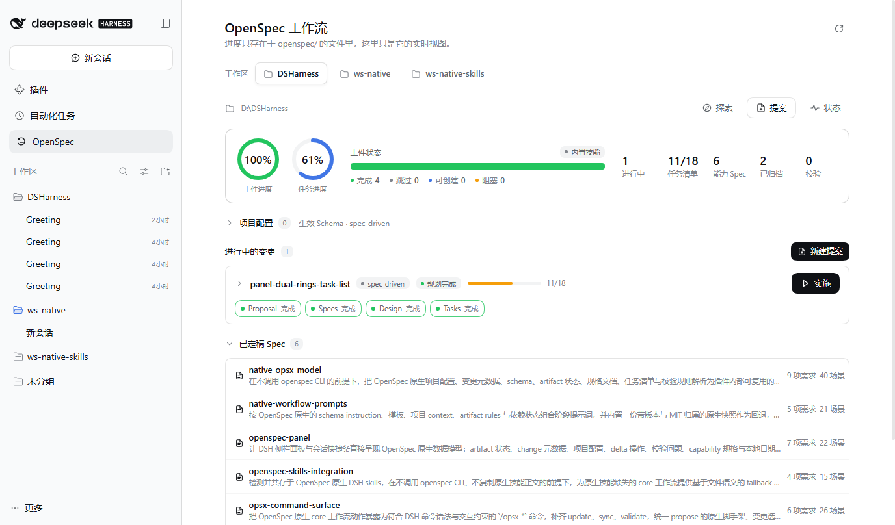
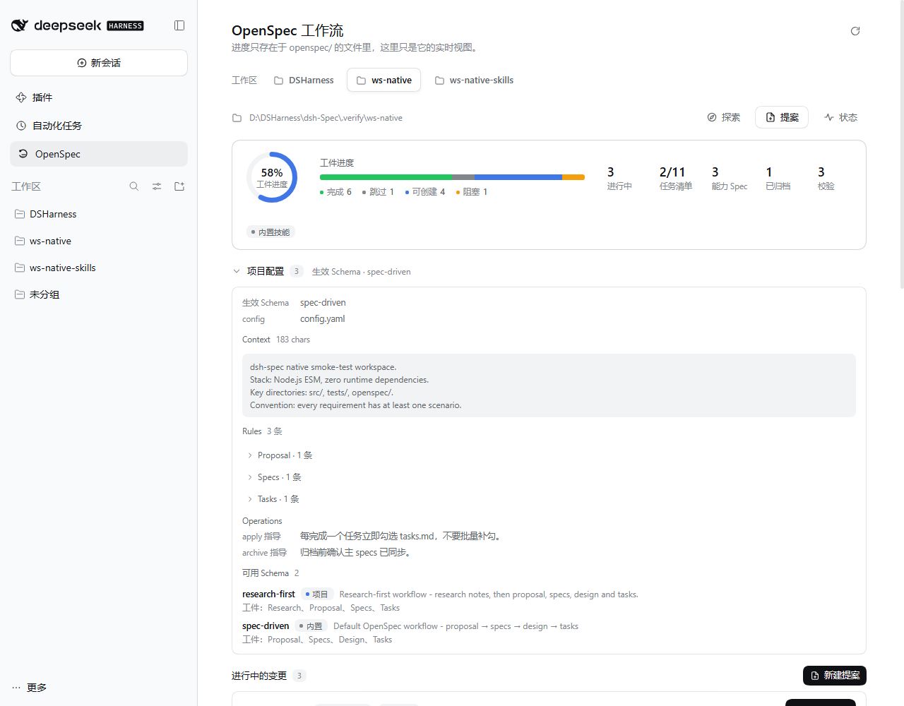
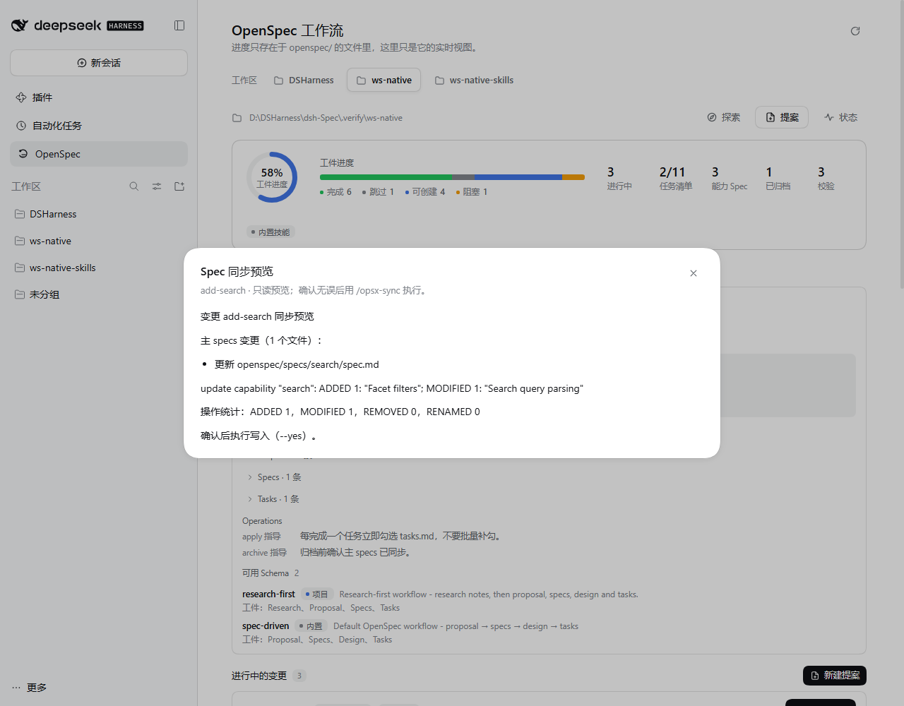
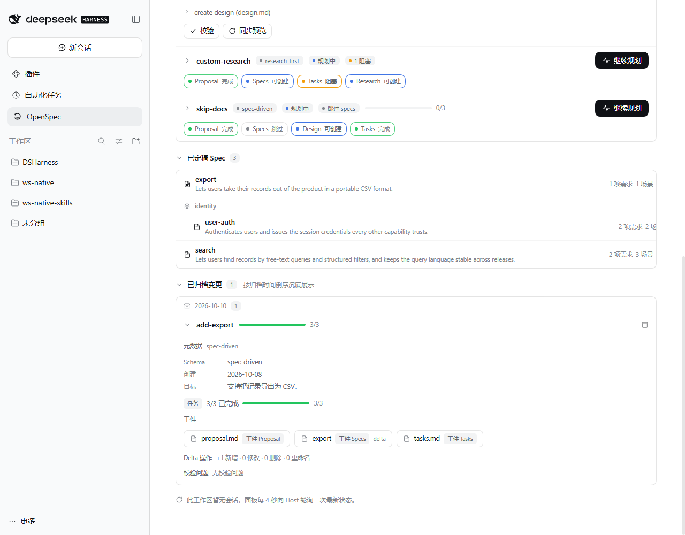
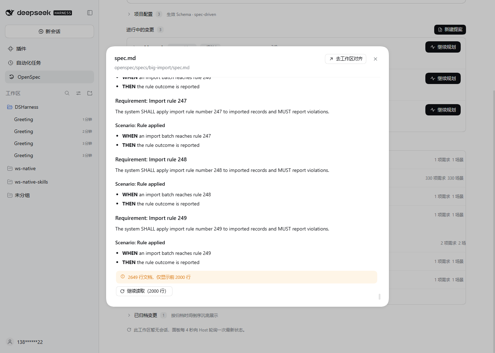
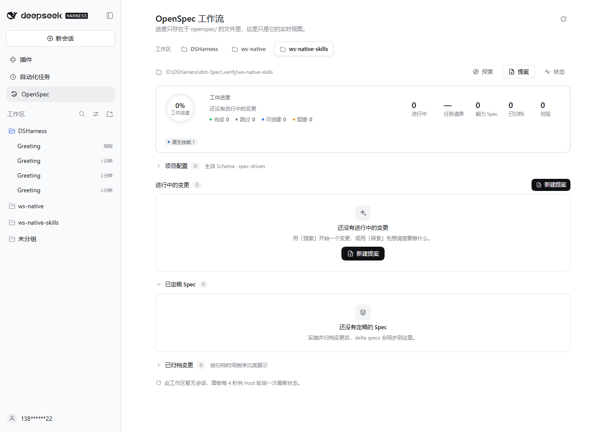
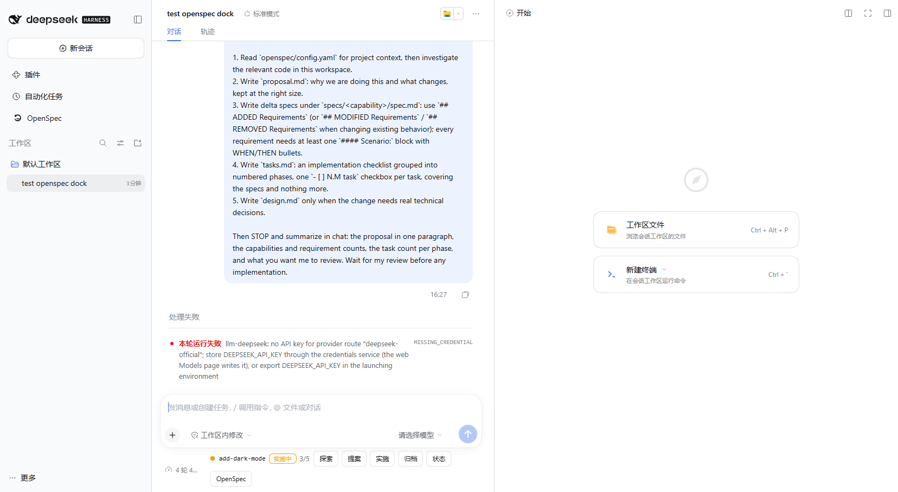
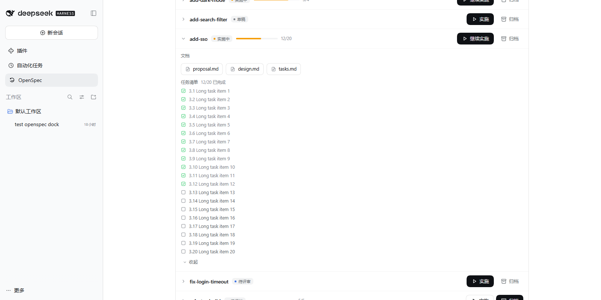

# dsh-spec — OpenSpec 原生语义的 DSH 前端

把 [OpenSpec](https://github.com/Fission-AI/OpenSpec) 的规格驱动开发（SDD）工作流完整桥接进 DeepSeek Harness（DSH）：**工作区原生面板 + 会话快捷命令条 + 九条 `/opsx-*` 命令**，直接读取仓库里的 `openspec/` 原生文件，**不依赖 openspec CLI**。

当前版本 **0.8.0**：面板概览为「工件进度 / 任务进度」两个独立进度圈，change 详情与归档详情带默认收起、可展开的任务清单；「探索 / 提案」入口点击后直接把命令填入输入框（不弹窗、不自动发送）；「归档」入口默认填入 `/opsx-archive <name>`（OPSX AI 归档工作流，新会话里回车即可切到对话并看到工作流）；DSH Web 客户端里多进行中 change 时，change 名可以从列表选择并自动回填输入框；六条阶段命令成功发起后会把会话标题改为 `[阶段] 主题`（`--yes` 收尾用 `[已同步]` / `[已归档]`）；sync / archive 的默认 AI 路径不再被校验 ERROR / 归档目标冲突前置拒绝（0.8.0，阻塞事实由 AI 先停止并报告）。

目标原生契约：**OpenSpec 1.14.3**（schema 驱动 OPSX）。插件内置一份带版本与 MIT 归属的 `spec-driven` schema + 四份模板快照，以及全部 12 个 OPSX 工作流 skills 的改编快照（上游 commit `c794978`，见 `src/native-snapshot/ATTRIBUTION.md`）；schema 仅当项目没有同名 `openspec/schemas/<name>/` 时作为回退，skills 仅当工作区没有原生 `openspec-*` 技能时作为 fallback。

```text
探索 想清楚 ──► 提案 写计划 ──► 人工评审 ──► 实施 逐项勾选 ──► 同步 specs ──► 归档
/opsx-explore    /opsx-propose                     /opsx-apply      /opsx-sync   /opsx-archive
```

## 截图（本机 DSH Web 验证实例，0.6.0）

| 面板（工件/任务双进度圈 · artifact chips · 原生下一步） | 项目配置与可用 schema |
|---|---|
|  |  |

| 同步 dry-run 预览 | 归档视图（本地日期分组 + 按需详情） |
|---|---|
|  |  |

| 长文档截断提示 + 继续读取 | 检测到原生 OpenSpec skills |
|---|---|
|  |  |

| 会话快捷条（原生下一步 / 任务进度 / skills 指示） | 变更详情（任务清单默认收起 / 展开） |
|---|---|
|  |  |

## 命令面与原生映射

DSH 的命令名只能是 `[a-z0-9_-]`，原生 `/opsx:*` 冒号语法无法注册，因此统一映射为 kebab-case。每条命令的描述里也标注了对应原生动作。

| 原生 | DSH 命令 | 作用 |
|---|---|---|
| `opsx:explore` | `/opsx-explore [主题]` | 只调查、讨论、给出选项与建议；**不写任何文件** |
| `opsx:propose` | `/opsx-propose <name> [说明]` | 幂等初始化 → 创建 `openspec/changes/<name>/` 与原生 `.openspec.yaml` → 提交 plan-only 提示词并停下等评审 |
| `opsx:update` | `/opsx-update [name] [修订要求]` | 只修改已有规划工件并保持工件间一致；代码改动交给 apply |
| `opsx:apply` | `/opsx-apply [name]` | 从第一个未勾选任务继续实施，随做随勾 `tasks.md` |
| `opsx:sync` | `/opsx-sync [name] [--yes\|--dry-run]` | 默认提交 OPSX `sync-specs` AI 工作流（评估 → 确认 → 智能合并 → 按契约验证）；`--yes` 走确定性合并，`--dry-run` 只读预览 |
| `opsx:archive` | `/opsx-archive [name] [--yes\|--dry-run\|--skip-specs]` | 默认提交 OPSX `archive-change` AI 工作流（完成度检查 → 同步评估 → 智能合并 → 验证 → 确定性收尾移动）；`--yes` 走确定性合并+移动，`--dry-run` 只预览，`--skip-specs` 只移动 |
| — | `/opsx-validate [name]` | 直接输出原生分级校验结果（ERROR / WARNING / INFO），不占模型 token |
| — | `/opsx-status` | 直接输出进行中变更、artifact 状态、任务进度与已归档数量 |
| — | `/openspec-init` | 幂等创建原生骨架（`config.yaml` + `specs/` + `changes/archive/`） |

**变更名选择器（DSH Web 客户端）**：需要 change 名的五条命令（`/opsx-update`、`/opsx-apply`、`/opsx-sync`、`/opsx-archive`、`/opsx-validate`）在**存在两个及以上进行中 change** 时，裸提交该命令（或在 `/` 菜单里不带参数选中它）会先弹出「选择变更」列表，而不是直接执行。列表可打字筛选、方向键与回车选择，每行显示 change 名与原生状态摘要（规划中 / 可实施 / 已完成、任务进度、校验问题数、`skip_specs`）；选中后只把 `/opsx-<command> <change-name> ` 填入会话输入框（光标在末尾、不自动发送），补充修订要求或 `--yes` 等参数后回车才执行。只有一个进行中 change 时仍是自动选中、不弹列表；没有进行中 change 时仍是既有提示；手打参数的命令行不受影响；Esc 取消不改写草稿、不发送消息。该交互依赖 DSH 0.2.x Web 客户端的命令选择弹层（`commandUi.decorate` + `popupSelect`，与 `/model` 同款），非 Web 客户端或未提供该能力的组合下命令行为保持不变；DSH 不支持空格后的内联参数补全，所以是「回车 / 菜单选中 → 二级列表」而不是边打边补全。

**阶段会话标题（Host 侧）**：六条模型阶段命令成功发起后，会把当前会话标题设为 `[阶段] 主题`：`[探索]`（用命令输入的主题）、`[提案]` / `[实施]` / `[更新]` / `[同步]` / `[归档]`（用实际选中的 change 名）。`/opsx-sync --yes` 与 `/opsx-archive --yes`（含 `--skip-specs`）成功收尾时分别使用 `[已同步]` 与 `[已归档]`。主题会压成单行并先按 UTF-8 字节裁剪到会话标题服务的 80 字节上限（超长补 `…`），阶段前缀始终保留。`/opsx-status`、`/opsx-validate`、`/openspec-init`、`--dry-run` 与失败命令不改标题；重复执行同一阶段命令不会重复写入标题事件；标题服务缺失或写入失败时静默跳过，不影响命令结果。取舍：显式设置标题会**钉住**该会话（之后不再自动更新标题），用户手动改名也会被下一次阶段命令覆盖；该能力依赖 DSH 组合挂载 `@deepseek-ai/dsh-session-title`。

`sync` / `archive` 有**两条路径**：

- **默认（AI 工作流）**：命令把「内置 OPSX 工作流正文 + 当前引擎事实（artifact / 任务 / delta / 主 spec / 校验问题 / 归档目标状态 / context / rules）+ 验证与收尾契约」作为用户消息提交给模型，命令本身不写盘。默认路径**先提交、后门禁**（0.8.0）：即使原生校验有 ERROR 或归档目标已存在，命令也照常提交工作流提示词，把阻塞事实写进 facts 与命令结果文案，由模型按提示词的 STOP gate 先停止并报告问题/冲突，不合并主 specs、不移动目录；无阻塞时模型按 OPSX 逻辑向用户确认、直接编辑主 specs 完成智能合并或跳过同步，验证后调用 `/opsx-archive <name> --yes --skip-specs` 收尾（archive）或 `/opsx-validate` 复核（sync）。
- **确定性快路径（`--yes` / `--dry-run`）**：不经过模型，校验门禁 → 计划 → 内存生成内容 → 临时文件 + rename 写入；校验 ERROR 与已存在的归档目标一律在命令层拒绝，失败不落盘；`--dry-run` 只预览。合并规则完整支持 `ADDED` / `MODIFIED` / `REMOVED` / `RENAMED`，delta 未提及的内容逐字节保留。

**范围说明**：命令面仍只覆盖原生 core 工作流（九条命令）。expanded 工作流（`new` / `continue` / `ff` / `verify` / `bulk-archive` / `onboard`）以**内置 skill 的文件语义**提供，不新增 `/opsx-*` 命令；store / workspace / initiative 进阶模型不在范围内。

## 内置 OPSX 工作流 skills（12 个，MIT）

插件把上游 OpenSpec 1.14.3 的 **12 个 OPSX skills** 逐字内置为快照（`src/native-snapshot/skills/<name>/SKILL.md`），运行时由 `src/native/skill-adaptation.js` 注入一层「openspec CLI → 读工作区文件 / `/opsx-*` 命令」适配说明：

`openspec-explore`、`openspec-propose`、`openspec-apply-change`、`openspec-update-change`、`openspec-sync-specs`、`openspec-archive-change`、`openspec-new-change`、`openspec-continue-change`、`openspec-ff-change`、`openspec-verify-change`、`openspec-bulk-archive-change`、`openspec-onboard`。

- **原生技能缺失时**：注册工作区感知的 fallback provider，返回这 12 个改编技能，模型可直接按 OPSX 步骤工作；
- **原生技能存在时**：fallback 不注册同名候选（项目 `.dsh/skills` / `.agents/skills` 优先级更高），插件从不修改原生技能文件；
- **归属**：正文来自 [Fission-AI/OpenSpec](https://github.com/Fission-AI/OpenSpec)（MIT，1.14.3，commit `c794978`）；frontmatter 记录 `vendoredFrom` / `upstreamVersion` / `upstreamCommit`，`ATTRIBUTION.md` 记录提取与刷新方式，`tools/sync-native-snapshot.mjs --source <OpenSpec 仓库>` 可复现刷新。

## 它长什么样

### 工作区面板（对话开始前也能用）

侧栏点 **OpenSpec** 图标进入。面板不再套用固定四阶段，而是展示 OpenSpec 原生数据模型：

- **工作区概览**：工件进度与任务进度两个独立进度圈——工件圈按 `(done + skipped) / artifact 总数`、任务圈按 `已勾选 / 任务总数` 分别聚合，各圈到 100% 才变绿；没有任务清单时任务圈显示 `—` 而不是 0%，规划完成不会被读成整体完成；旁边保留 artifact 状态分布条；
- **项目配置**：生效 schema、context 摘要、按 artifact 分组的 rules、项目本地与内置快照 schema 来源；
- **进行中的变更**：生效 schema 名、每个 artifact 的原生状态（`done` / `skipped` / `ready` / `blocked`）、可展开的 `missingDeps`、`skip_specs` 信号、独立的任务进度，以及按 artifact 状态推导的下一步动作；
- **变更详情**：工件文档按 schema 的 `generates` 路径列出（自定义 artifact、glob 输出都能显示），`.openspec.yaml` 元数据（schema / created / goal / skip_specs），默认收起、可展开的任务清单（勾选状态、编号与层级；超过 200 条 / change 的载入上限时显式提示剩余条目），delta 操作统计（ADDED / MODIFIED / REMOVED / RENAMED），以及带文件路径与行号的分级校验问题；
- **能力 Spec**：每个 capability 的 Purpose、requirement / scenario 数量与校验问题，嵌套路径（如 `identity/user-auth`）按层级分组；
- **已归档**：按本地归档日期分组，按需读取工件、任务勾选明细与元数据；
- **不做静默截断**：列表超出单页显示分页/「还有 N 个」，任务清单超过载入上限显示「还有 N 项，打开 tasks.md」，文档读取被截断时显示提示并支持继续读取。

无会话的工作区由面板每 4s 轮询 Host 只读接口；有会话时以 `workspaceFiles` 文件监听为主，并保留每 4s 的轮询兜底（目录重命名/归档移动不一定触发文件监听，轮询保证快捷条的「归档」按钮在归档后几秒内切换到下一步）。界面不存任何隐藏状态——所有内容每次从文件推导。

工作区还没有 `openspec/` 时，卡片给出一键初始化，生成与原生一致的骨架（`config.yaml`、`specs/`、`changes/archive/` 锚点），不写 README、不写占位 context，已存在文件一律不覆盖。

### 会话快捷命令条

**新会话（还没发第一条消息）时**，快捷条并入「工作区 / 模式」那一行的右端（`conversation.hero.options` 槽位），不额外占一行；对话开始后它切换到输入框下方（`conversation.composer.dock` 槽位），两者互斥不会重复。条上显示：当前变更名、artifact 状态摘要、任务进度，加上按原生下一步推导的动作按钮（探索 / 提案 / 实施 / 更新 / 同步 / 归档 / 状态）与「检测到的原生 OpenSpec skills」指示。

其中「归档」按钮默认填入 **`/opsx-archive <name>`**：回车即提交 OPSX AI 归档工作流（完成度检查 → 同步评估 → 智能合并 → 验证 → `/opsx-archive <name> --yes --skip-specs` 确定性收尾），AI 会先向用户确认再动手。**新会话（还没进入对话）里也必须用 AI 路径**：确定性 `--yes` 返回的是直接命令结果，DSH 只在会话轨迹里渲染，hero 页没有轨迹会静默丢弃（这正是 0.5.0 里「点归档没反应」的原因）。默认 AI 路径不再被校验 ERROR / 归档目标冲突前置拒绝（0.8.0）：命令照样提交工作流提示词并由 AI 先停止、报告阻塞原因，因此新会话里点「归档」在任何校验/冲突状态下都会产生可见的模型回合。确定性归档仍可手动输入 `/opsx-archive <name> --yes`（校验 → 合并 → 移动，不产生模型消息）做一键收尾，`--dry-run` 只预览。

面板按钮**不自动执行**：点击会切到对应工作区的会话并把 `/opsx-*` 指令填入输入框；确认后再回车，避免误触直接跑模型。其中「探索」「提案」入口也走同一条路径——点击直接把 `/opsx-explore ` / `/opsx-propose ` 填入输入框（不再弹输入弹窗），主题或 change 名在输入框里补充。

界面完全使用 DSH 宿主的主题 token（`--dsw-*`）与弹窗规范：浅色 / 深色自动跟随。

## 原生语义：状态与校验

### artifact 状态只看文件

状态唯一来源：生效 schema 的 artifact 图 + 文件系统 + `.openspec.yaml`。

| 状态 | 判定 |
|---|---|
| `done` | artifact 的 `generates` 路径存在（glob 至少命中一个文件） |
| `skipped` | `.openspec.yaml` 的 `skip_specs: true` 跳过 specs artifact（并满足依赖它的 artifact） |
| `ready` | 依赖全部 done/skipped，且自身输出尚未生成 |
| `blocked` | 还有未完成的依赖，`missingDeps` 给出依赖 ID |

change 级状态为 `no-tasks` / `in-progress` / `complete`（任务进度独立展示，工作区概览用「工件进度 / 任务进度」双进度圈）；不再有 draft / proposed / apply / ready 这类硬编码阶段作为判定真相。

### 校验子集（高保真、非全量）

`/opsx-validate` 与面板校验问题是确定性的、只读的原生校验子集：proposal 的 `## Why` 长度（50–1000）与 `## What Changes`、delta 必须位于 `specs/<capability-path>/spec.md`、ADDED/MODIFIED requirement 的 SHALL/MUST 与 `#### Scenario:`、场景标题层级、`skip_specs` 与 delta 冲突、`tasks.md` 原生复选框解析（`-`/`*`/`+`，只有 `x` 算完成，`[~]`/空框算未完成，链接 bullet 忽略）、change 元数据与主 spec 必需章节。

不冒充全量：OpenSpec CLI 的一些错误/警告不在子集内，见「已知边界」。

## 安装与构建

仓库已提交构建产物 `lib/`，从 GitHub 面板安装不需要构建。本地开发改代码后：

```powershell
node tools/build.mjs
```

构建会：把 `src/host.js`、`src/prompts.js`、`src/commands.js` 原样拷到 `lib/`；把 `src/native/**` 与 `src/native-snapshot/**` 镜像到 `lib/`；把 `src/client-helpers.js` 内联进 `lib/client.js` 的 `__ModuleLoader__` 闭包。Host 半改动需要重启 DSH 进程，client 半改动重新构建后刷新页面即可。

```powershell
node --test --test-isolation=none "tests/*.test.mjs"
```

### 方式一：插件面板安装（推荐）

侧栏 **插件 → 添加插件**，填本地目录绝对路径（`link` 接入，改代码后构建 + 刷新页面）、Git 仓库地址（仓库自带 `lib/`）或 npm 包名（暂未发布）。首次安装需重启 DSH 一次；本插件零依赖、无安装脚本。

### 方式二：CLI

```powershell
dsh plugin --profile <profile> add D:\DSHarness\dsh-Spec
```

要求：DSH 0.2.x（web bundle），无需 Node CLI、无需安装 openspec。

## 与原生 OpenSpec skills 共存

插件会检测项目 `.dsh/skills`、项目 `.agents/skills`、用户技能根目录下的 `openspec-*` 技能，并在面板/快捷条展示其名称与覆盖的工作流。

- 检测到原生技能时：插件**不注册**同名 fallback，也不修改、移动或删除原生技能文件；
- 原生技能缺失且 DSH 组合提供 `ctx.skills` 时：注册工作区感知的 fallback 技能 provider，返回内置的 12 个 OPSX 工作流改编技能（正文来自上游 1.14.3，MIT；运行时注入 CLI→文件语义适配说明，不要求 openspec CLI）；
- 工作区后来出现原生技能时，下一次目录刷新 fallback 自动让位；组合没有 skills 能力时跳过注册，命令与面板照常工作。

## 架构

```text
src/host.js            Host 半：注册命令族、只读 /dsh-spec 路由（state / validate /
                       instructions[explore|propose|apply|update|sync|archive] /
                       sync-preview / document / archive-detail / init）、可选 fallback skills provider
src/commands.js        九条命令：变更选择、原生 propose 脚手架、AI sync/archive 工作流提交、
                       --yes 确定性快路径 / --dry-run 预览 / --skip-specs 收尾、
                       status/validate/init 直出
src/session-titles.js  阶段会话标题：`[阶段] 主题` 组合、UTF-8 裁剪、幂等写入与失败隔离
src/prompts.js         原生阶段提示词组合（explore / propose / apply / update）+
                       OPSX sync/archive 工作流提示词（vendored skill 正文 + 引擎事实 + 收尾契约）
src/native/**          纯 JS 原生语义引擎（零依赖、零子进程、零网络）：
                       yaml / config / metadata / schema / graph / spec / tasks / validate /
                       state / instruction / merge / archive / skills / skill-adaptation / init / fsio
src/native-snapshot/   固定版本 spec-driven schema + 模板 + 12 个 OPSX SKILL.md 快照（ATTRIBUTION 记录上游）
src/client.js          浏览器半：main 工作区面板 + sidebar.panellist 图标 +
                       conversation.composer.dock 快捷条 + conversation.hero.options
                       （对话开始前并入工作区行的入口）；只渲染 Host 推导的原生状态
src/client-helpers.js  纯展示辅助（artifact 标签/排序、delta 摘要、日期分组、分页切片、
                       工件/任务双进度口径与任务清单视图）
tools/build.mjs        构建（Host 半拷贝 + client 半内联，无打包器）
tools/sync-native-snapshot.mjs  开发期刷新内置 schema/模板/skills 快照与版本标记
tests/                 node:test 单元与集成测试（fixtures/workspace 为提交的稳定夹具）
```

设计原则：文件即真相源（零自有状态）、Host 侧单一语义引擎（面板/命令/提示词共用）、UI 走插槽与主题 token、文案走 locale（zh/en）、命令直出 UI 不占模型 token、原生快照与 OPSX skills 带版本与 MIT 归属、零新增运行时依赖。

### 刷新内置快照（schema / 模板 / 12 个 skills）

```powershell
node tools/sync-native-snapshot.mjs --source <path-to-OpenSpec-repo>
```

读取上游仓库的 `schemas/spec-driven/schema.yaml`、`schemas/spec-driven/templates/*.md` 与 `skills/openspec-*/SKILL.md`，刷新快照与 `ATTRIBUTION.md` 的版本/commit 标记；测试会校验快照结构与版本标记存在。来源缺失时脚本以非零状态明确报错。

## 已知边界

- **原生语义子集**：确定性路径的校验/合并是"高保真子集"，个别原生错误与警告不会出现；这是有意的取舍，README 与面板不把未覆盖规则伪装成已覆盖。
- **有意未覆盖的原生校验规则**：`--strict` 与默认模式的区分、proposal `Capabilities` 列表与 delta 文件的一一对应、`REMOVED` / `MODIFIED` / `RENAMED` 目标是否存在于主 spec 的*校验期*跨文件检查（改为合并/预览期以 ERROR 拒绝，不落盘）、`REMOVED` 的 `**Reason**` / `**Migration**` 强制、场景内 `WHEN` / `THEN` 的结构化检查、`affected_areas` / `initiative` 等进阶元数据语义。这些规则不影响确定性 sync/archive 的正确性，只是在 `/opsx-validate` 中不会出现对应的原生提示。
- **AI 智能合并的写盘风险**：默认 AI 工作流会直接编辑主 specs；提示词内嵌 canonical 验证契约并在收尾前要求校验，确定性 `--yes` 路径始终可作为对照与回退。
- **YAML 子集**：自研解析器覆盖评论、标量、块标量、缩进序列/映射、flow 集合与引号；anchor / merge key / 多行 flow 等结构会带行号报错，schema 解析失败时面板显示 schema 错误而不是静默回退默认 schema。
- **上下文长度**：`openspec/config.yaml` 的 `context` 超过 50KB 会被忽略并给出警告。
- **会话作用域**：快捷条在新会话（还没发第一条消息）时并入「工作区 / 模式」行右端（`conversation.hero.options`），对话开始后由输入框下方的 `conversation.composer.dock` 接棒（二者由 hero 状态天然互斥，不会同时出现）；完全无会话时请用面板（面板走 Host 只读接口，无需会话）。`/` 菜单仍只在有会话时出现。
- **新会话里的命令结果可见性**：hero 页没有会话轨迹，只有会**产生模型回合**的命令（探索 / 提案 / 实施 / 更新 / 同步 / 归档的默认 AI 路径）能在提交后切到对话并显示结果；返回直接命令结果的命令（`/opsx-status`、`/opsx-validate`、`--yes` 确定性归档等）需要已有会话轨迹才能看到输出，在新会话里提交它们会静默完成/失败、界面停在 hero。归档按钮因此固定走 AI 路径（0.6.0 修复），且 sync / archive 的默认 AI 路径不再被校验 ERROR / 归档目标冲突前置拒绝（0.8.0）：阻塞事实交给模型先停止并报告，确定性路径仍在命令层拒绝——无效 change 请先用 `/opsx-update <name>` 修复。
- **写操作只走命令**：面板不直接写盘；sync / archive 由用户执行命令触发（默认 AI 工作流不写盘，`--yes` 才确定性写盘）。
- **expanded 命令族**：new / continue / ff / verify / bulk-archive / onboard 只通过内置 OPSX skills（文件语义）提供，不提供对应 `/opsx-*` 命令。
- **变更选择器边界**：仅在 DSH Web 客户端、且工作区存在 ≥2 个进行中 change 时接管五条 change 命令；不做空格后的内联补全、不提供 sync / archive 标志（`--yes` / `--dry-run` / `--skip-specs`）的第二级选择、不选择已归档 change；`/` 菜单点选这五条命令从不带参数状态变为先弹选择器（Esc 或手打命令 + 空格仍走旧路径）；选择器打开时若 Host 状态读取失败，只在弹层内报错，不执行命令、不发送消息。
- 提案/实施由 AI 执行，需要会话已配置模型；插件本身不调用模型（AI 工作流提示词由命令提交给会话模型）。

## License

MIT。OpenSpec 工作流语义、schema/模板快照与 12 个 OPSX skills 正文来自 [Fission-AI/OpenSpec](https://github.com/Fission-AI/OpenSpec)（MIT，1.14.3，commit `c794978`），归属与提取/刷新说明见 `src/native-snapshot/ATTRIBUTION.md`。
