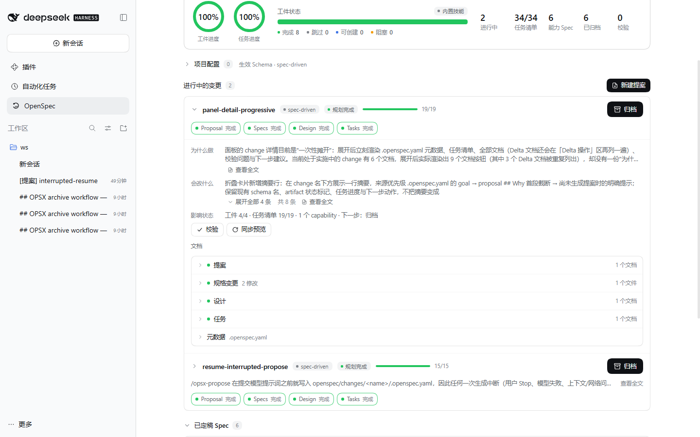
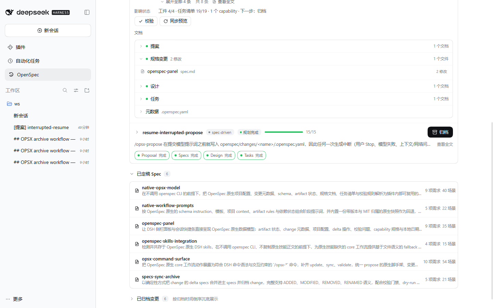
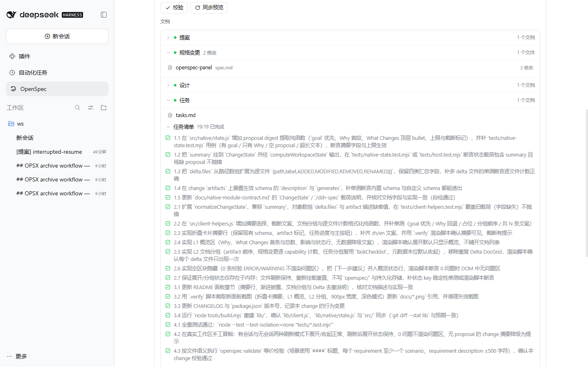
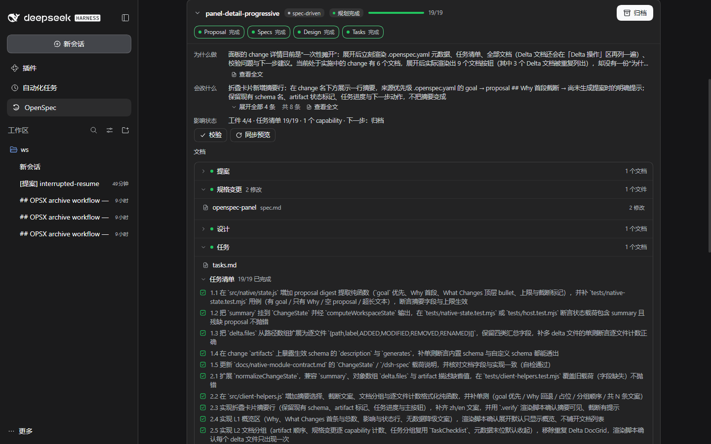
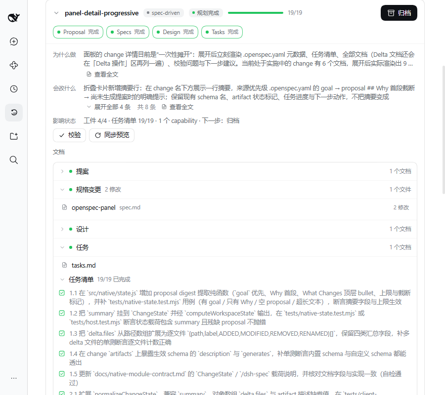
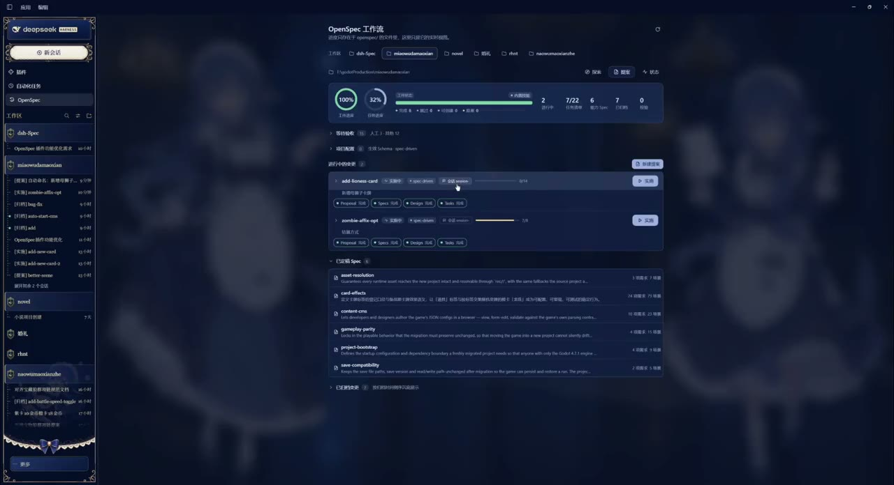
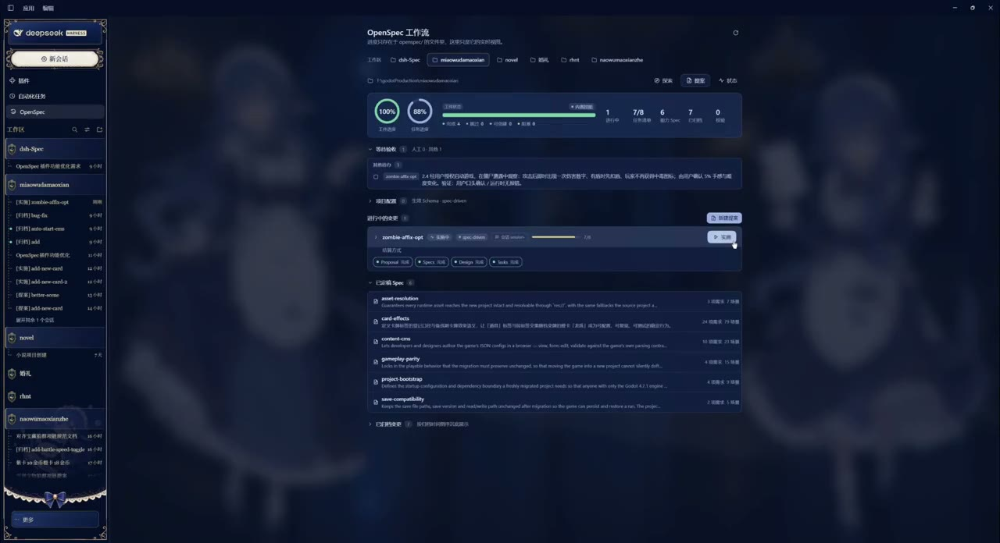
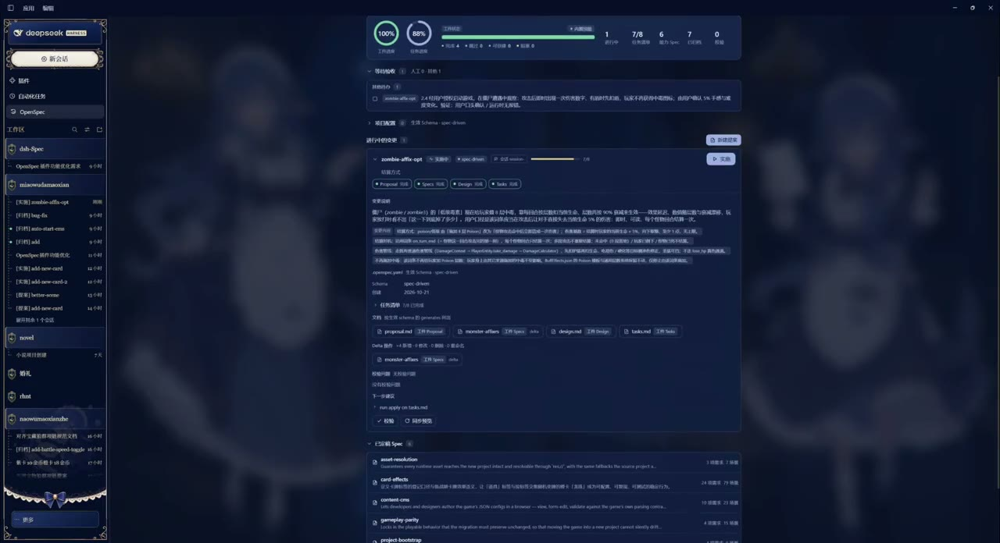

# dsh-spec

在 DeepSeek Harness 中管理 OpenSpec 项目：以 `openspec/` 文件为唯一状态源，提供变更面板、会话绑定与 `/opsx-*` 命令，不依赖 openspec CLI。

当前版本 **0.10.1**：面板 change 卡片折叠态显示一行摘要，详情改为渐进式披露——展开先给概览（Why / What Changes / 影响状态），文档按 artifact 分组且默认收起，Delta 文档只列一次并带逐文件操作计数，0 校验问题与空区块不占位，展开状态只存在于内存；同时保留 0.9.x 的会话绑定、实时状态、等待验收、AI 自动命名与人工验收勾选。0.10.1 起，长驻 DSH 进程仍加载旧 Host 时，浏览器半会回读 `proposal.md` 自补简略区，刷新页面即可看到 Why / What Changes，无需先重启。

## 为什么是 SDD

规格驱动开发（Spec-Driven Development，SDD）主张先写清「意图、行为契约与验收标准」，再进入实现。其收益主要在四个方面：

- **降低返工成本**：边界条件、失败路径与兼容性约束在写代码前暴露，而不是在联调或上线后才发现；
- **评审前移**：规格的 review 成本显著低于实现后的返工，讨论也更聚焦于行为而非代码细节；
- **实现可验证**：需求、场景、任务与最终行为之间存在可追溯的对应关系，验收标准不再含糊；
- **协作上下文稳定**：无论人还是 AI，都基于同一份显式规格工作，减少口头约定与上下文漂移。

OpenSpec 是 SDD 的一种轻量实现：把上述规格与任务落到仓库文件，而不是引入重型流程或专用服务。

## OpenSpec 的价值

OpenSpec 的核心机制，是将变更的规划与执行状态外化为仓库内的显式工件：`proposal.md`、delta specs、`design.md`、`tasks.md` 与归档记录。其首要收益是**状态的持久化与可恢复性**：会话只是执行载体，即使对话中断、上下文丢失或更换模型/客户端，任务状态仍可从 `openspec/changes/<name>/` 恢复，而不依赖会话历史。

由此派生的性质包括：

- **可审计**：每个阶段的产物均为 Markdown/YAML，可 diff、review、回滚；
- **增量规格**：实施期间只修改变更内的 delta，归档时再合并进主规格，避免主规格被过程性修改污染；
- **阶段边界清晰**：proposal → specs/design → tasks → apply → sync → archive，AI 与人都知道当前该做什么；
- **工具无关**：Git 即历史，无需数据库或专用服务。

## 插件提供的便利

- **单一视图**：工件进度、任务进度、变更状态、摘要、等待验收任务与归档记录集中在一个面板。
- **一变更一会话**：每个 change 绑定独立会话，可并行推进；切换 change 自动回到对应会话。
- **操作直达**：面板按钮直接执行 `/opsx-*`，无需填写命令后再按一次回车；直接执行失败（如目标会话运行中）时自动把命令填入该会话输入框，由你手动发送。
- **运行态可见**：会话运行或等待权限时禁用主操作；完成后通知并恢复。
- **等待验收**：汇总所有未勾选任务，按「人工验收 / 其他待办」分组，可勾选或打开 `tasks.md`。
- **AI 总结命名**：提案只需描述；AI 概括要点、选择 change 名并创建工件。
- **原生兼容**：优先使用项目已有的 OpenSpec skills；缺失时提供内置 OPSX 工作流。

## 快速开始

要求 DSH 0.2.x，无需安装 openspec CLI。

安装方式：

- 侧栏「插件 → 添加插件」，填本地目录、Git 地址或包名；首次安装后重启 DSH。
- 或使用 CLI：

```powershell
dsh plugin --profile <profile> add <插件目录或仓库地址>
```

工作区没有 `openspec/` 时，在面板点击「初始化 OpenSpec」，生成 `config.yaml`、`specs/` 与 `changes/archive/`，不覆盖已有文件。

本地开发：

```powershell
node tools/build.mjs
node --test --test-isolation=none "tests/*.test.mjs"
```

Host 半改动需重启 DSH；client 半重新构建后刷新页面。混版运行时（旧 Host + 新 client）面板会按需回读 `proposal.md` 补全简略区，因此升级 client 后不必为了「为什么做 / 会改什么」而重启进程；Host 侧新增能力仍以重启 DSH 为准。

## 截图（0.10.0）

本机 DSH Web 验证实例，展示渐进式变更详情、文档分组与双进度圈：

| 面板（工件/任务双进度圈 · 摘要行 · 原生下一步） | 变更详情：概览优先（Why / 会改什么 / 影响状态） |
|---|---|
|  |  |

| 变更详情：文档分组（Delta 只列一次） | 变更详情：任务清单按需展开 |
|---|---|
|  |  |

| 深色模式 | 900px 窄屏 |
|---|---|
|  |  |

| 会话快捷条（原生下一步 / 任务进度） | 归档视图（本地日期分组） |
|---|---|
|  |  |

## 演示视频

点击缩略图播放或下载 MP4。

| 多任务并行不抢会话窗口 | 一键使用与实时状态更新 | 变更自动提取摘要信息 |
|---|---|---|
| [](docs/videos/multi-session-parallel.mp4) | [](docs/videos/one-click-live-status.mp4) | [](docs/videos/auto-summary.mp4) |
| 每个 change 绑定独立会话，切换不打断。<br>[▶ 播放](docs/videos/multi-session-parallel.mp4) | 面板按钮直接执行，状态实时刷新。<br>[▶ 播放](docs/videos/one-click-live-status.mp4) | AI 概括描述，生成一句话摘要。<br>[▶ 播放](docs/videos/auto-summary.mp4) |

## 使用

### 总览与等待验收

顶部为工件/任务双进度圈及统计信息。其下的「等待验收」汇总所有未勾选任务：

- 按「人工验收 / 其他待办」分组并显示数量；
- 可直接勾选，或点击行打开对应 `tasks.md` 并定位行号；
- 变更会话运行中时禁用勾选；任务超出 200 条载入上限时提示查看原文件。

### 变更卡片

卡片显示 change 名、实时状态、绑定会话、工件 chips、任务进度与下一步操作。折叠时显示**一行摘要**（`.openspec.yaml` 的 `goal` → proposal `## Why` 首段 → 「尚未生成提案」提示），截断时提供「查看全文」入口。

展开后为渐进式详情：先给概览（Why 摘要、What Changes 首条与总条数、影响范围与状态、校验 / 同步预览入口）；文档按生效 schema 的 artifact 分组且默认收起，规格变更按 capability 各列一次并显示该文件 ADDED / MODIFIED / REMOVED / RENAMED 计数，Delta 文档只出现一次；0 条校验问题不渲染问题区，元数据降为末位折叠分组，任务清单在「任务」分组内可展开，并支持 `[人工验收]` 任务的手动勾选。展开状态只是内存视图态，不写入 `openspec/` 或插件存储。

### 提案与探索

「提案」只需填写描述。插件发送 `/opsx-propose --auto <描述>`，AI 将：

1. 概括描述；
2. 选择 kebab-case 的 change 名（避开已有 change）；
3. 写入 `goal`（一句话中文摘要）、`.openspec.yaml` 与规划工件；
4. 停止并等待评审。

已确定名称时可直接使用：

```text
/opsx-propose my-change-name 变更说明
```

「探索」为只读调查与讨论，不写文件。

### 快捷条、绑定与状态

快捷条在空白会话中并入「工作区 / 模式」行，对话开始后移至输入框下方。

- 一个 change 绑定一个会话，绑定保存在当前浏览器；
- 手打阶段命令时，按会话标题 `[阶段] 主题` 自动补绑定；
- 运行中或等待确认时禁用主操作；
- 完成或需要权限时发送系统通知（未授权则回退为页内提示）。

### 通知与文档

系统通知需浏览器授权。Markdown 文档在面板内的大尺寸阅读器中打开，支持放大、截断后继续读取与「去工作区对齐」。

## 命令

DSH 命令名不能带冒号，原生 `/opsx:*` 映射为 kebab-case：

| 原生 | DSH 命令 | 作用 |
|---|---|---|
| `opsx:explore` | `/opsx-explore [主题]` | 只读调查与讨论 |
| `opsx:propose` | `/opsx-propose <name> [说明]` 或 `/opsx-propose --auto <描述>` | 创建 change 与规划工件；`--auto` 由 AI 总结并命名 |
| `opsx:update` | `/opsx-update [name] [修订要求]` | 只修订已有规划工件 |
| `opsx:apply` | `/opsx-apply [name]` | 从首个未勾选任务继续实施 |
| `opsx:sync` | `/opsx-sync [name] [--yes\|--dry-run]` | 默认 AI 工作流；`--yes` 确定性合并，`--dry-run` 只预览 |
| `opsx:archive` | `/opsx-archive [name] [--yes\|--dry-run\|--skip-specs]` | 默认 AI 工作流；`--yes` 确定性归档，`--skip-specs` 只移动 |
| — | `/opsx-validate [name]` | 直接输出原生分级校验结果 |
| — | `/opsx-status` | 直接输出进行中变更、工件状态、任务进度与归档数量 |
| — | `/openspec-init` | 幂等创建原生骨架 |

### 命令细节

- **多变更选择器**：存在 ≥2 个进行中 change 时，裸提交上述 change 命令会先弹出列表；选中后回填命令。
- **阶段标题**：阶段命令成功后会话标题变为 `[探索] 主题`、`[提案] change` 等；`--yes` 收尾用 `[已同步]` / `[已归档]`。
- **sync / archive**：默认 AI 路径先评估、确认，再编辑主 specs / 归档；即使校验有 ERROR 或归档目标已存在，也先提交提示词，由 AI 按 STOP gate 停止并报告。确定性 `--yes` 在命令层拒绝并保证失败不落盘。
- **范围**：核心工作流提供命令；`new` / `continue` / `ff` / `verify` / `bulk-archive` / `onboard` 通过内置文件语义 skills 提供；store / workspace / initiative 不在范围内。

## 内置 OPSX 工作流 skills

插件内置上游 OpenSpec 1.14.3 的 12 个 OPSX skills（`src/native-snapshot/skills/`），运行时注入「CLI → 工作区文件」适配说明。原生技能存在时优先使用且不修改；缺失时注册工作区感知的 fallback。归属与刷新方式见 `src/native-snapshot/ATTRIBUTION.md`。

## 原生语义

artifact 状态仅由文件决定：

| 状态 | 判定 |
|---|---|
| `done` | `generates` 路径存在 |
| `skipped` | `skip_specs: true` 跳过 specs |
| `ready` | 依赖已完成，自身输出未生成 |
| `blocked` | 仍有未完成依赖，`missingDeps` 给出 ID |

`/opsx-validate` 与面板校验问题为确定性的原生校验子集：proposal 的 `## Why` 长度、`## What Changes`、delta 位置、ADDED/MODIFIED requirement 的 SHALL/MUST 与场景标题层级、`skip_specs` 冲突、`tasks.md` 复选框解析、change 元数据与主 spec 必需章节。非全量规则见「已知边界」。

## 架构

```text
src/host.js            Host 半：命令族、/dsh-spec 路由、fallback skills provider
src/commands.js        九条命令：变更选择、propose 脚手架、AI sync/archive、确定性路径、直出
src/session-titles.js  阶段会话标题组合与幂等写入
src/prompts.js         阶段提示词、OPSX sync/archive 提示词、AI 自动命名提示词
src/native/**          纯 JS 原生语义引擎：yaml / config / metadata / schema / graph /
                       spec / summary / tasks / validate / state / instruction / merge /
                       archive / skills / skill-adaptation / init / fsio
src/native-snapshot/   固定版本 schema、模板与 12 个 OPSX SKILL.md 快照
src/client.js          浏览器半：面板、快捷条、绑定、直接执行、状态订阅、通知、文档阅读器
src/client-helpers.js  纯展示辅助：排序、摘要、分页、任务清单、等待验收聚合
tools/build.mjs        构建（Host 拷贝 + client 内联，无打包器）
tools/sync-native-snapshot.mjs  开发期刷新内置 schema/模板/skills 快照与版本标记
tests/                 node:test 单元与集成测试
```

设计原则：文件即真相源；Host 侧单一语义引擎；UI 使用宿主插槽与主题 token；命令直出不占模型 token；原生快照带版本与 MIT 归属；零新增运行时依赖。

## 已知边界

- **原生语义子集**：校验/合成为高保真子集，个别原生错误与警告不出现。
- **未覆盖的校验规则**：`--strict` 与默认模式区分、proposal `Capabilities` 与 delta 一一对应、`REMOVED` / `MODIFIED` / `RENAMED` 目标的跨文件校验、`**Reason**` / `**Migration**` 强制、场景内 `WHEN` / `THEN` 结构化检查等。
- **AI 合并风险**：默认 AI 工作流直接编辑主 specs；确定性 `--yes` 可作为对照与回退。
- **YAML 子集**：anchor / merge key / 多行 flow 等结构会带行号报错。
- **上下文长度**：`openspec/config.yaml` 的 `context` 超过 50KB 会被忽略并警告。
- **绑定作用域**：绑定保存在浏览器 `localStorage`，不写入仓库；换浏览器后可按会话标题重建或新建会话。
- **任务勾选**：`task-toggle` 只改写 `tasks.md` 的目标行；行号失效或非任务行会被拒绝。
- **模型依赖**：提案/实施由 AI 执行，需要会话已配置模型；插件本身不调用模型。
- **选择器边界**：仅在 Web 客户端、≥2 个进行中 change 时接管 change 命令；不做内联补全与标志二级选择。
- **新会话里的命令结果可见性**：hero 页没有会话轨迹，只有会产生模型回合的命令（探索 / 提案 / 实施 / 更新 / 同步 / 归档的默认 AI 路径）能在提交后切到对话并显示结果；返回直接命令结果的命令（`/opsx-status`、`/opsx-validate`、`--yes` 确定性归档、规划已完成的 `/opsx-propose` 直出等）需要已有会话轨迹才能看到输出。归档按钮因此固定走 AI 路径。
- **propose 续做边界**：同名 `/opsx-propose` 对已存在 change 按原生状态分支——规划未完成时原地续做（不重写 `.openspec.yaml`，只创建缺失工件；已有工件只读），规划已完成时直出下一步指引、不产生模型回合。`specs/**` 完整性由提示词按 capability 核对，不是引擎级强校验；中断造成的孤立 change 不会被自动删除或回滚。
- **面板失败兜底**：面板动作优先直接执行；被拒绝或执行失败时回退为「把命令填入目标会话输入框」而不自动发送，因此失败不再表现为点击无反应，最终发送仍由用户确认。
- **写操作只走命令**：面板不直接写盘；sync / archive 由用户执行命令触发（默认 AI 工作流不写盘，`--yes` 才确定性写盘）。
- **expanded 命令族**：new / continue / ff / verify / bulk-archive / onboard 只通过内置 OPSX skills（文件语义）提供，不提供对应 `/opsx-*` 命令。

## License

MIT。OpenSpec 工作流语义、schema/模板快照与 12 个 OPSX skills 正文来自 [Fission-AI/OpenSpec](https://github.com/Fission-AI/OpenSpec)（MIT，1.14.3，commit `c794978`），归属见 `src/native-snapshot/ATTRIBUTION.md`。
