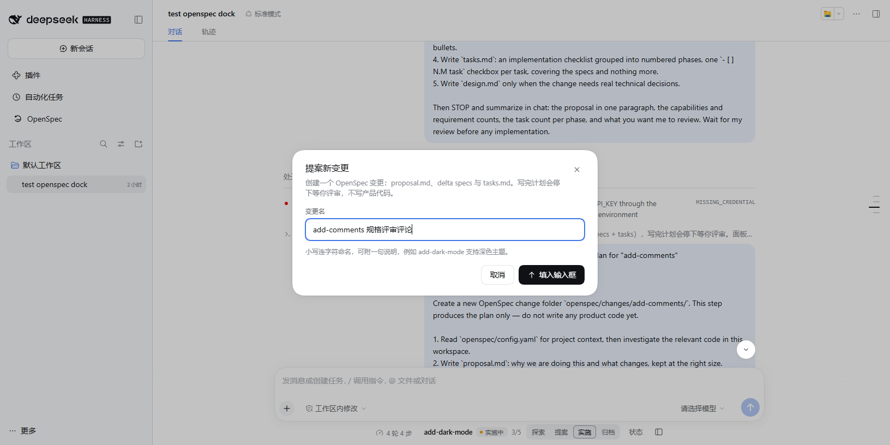

# dsh-spec — OpenSpec 工作流的 DSH 适配插件

把 [OpenSpec](https://github.com/Fission-AI/OpenSpec) 的规格驱动开发（SDD）工作流完整桥接进 DeepSeek Harness（DSH）：**实时监控面板 + 会话快捷命令条 + `/opsx-*` 阶段命令**，不依赖 openspec CLI。

```text
探索 想清楚 ──► 提案 写计划 ──► 人工评审 ──► 实施 逐项勾选 ──► 归档 同步 specs
/opsx-explore    /opsx-propose                     /opsx-apply       /opsx-archive
```

## 它长什么样

### 监控面板（对话开始前也能用）

侧栏点 **OpenSpec** 图标进入。每个工作区一张卡片：变更列表、阶段徽标、任务进度条（来自 `tasks.md` 复选框）、工件文件、归档计数；目录监听实时刷新。工作区级的「探索 / 提案 / 状态」在卡片头部，单个变更的「实施 / 归档」在行右侧。


工作区还没有 `openspec/` 时，卡片给出一键初始化（生成 `config.yaml`、`specs/`、`changes/archive/` 骨架）：


### 会话快捷命令条

会话开始后，输入框下方常驻一条：当前变更名、阶段徽标、任务进度，加上 `探索 / 提案 / 实施 / 归档` 四段式命令组（工作流建议的下一步会自动高亮）和「状态」，最右侧图标直达面板。


### 点「提案」→ 原生风格弹窗

点「提案」弹出一个与 DSH 宿主对话框同款的窗口：填写 `change-name`（可附说明）后，「填入输入框」把完整指令写进会话草稿，交给用户补完再回车；面板里的同名按钮则直接执行并切到会话。多个变更并行时「实施」会弹出变更选择窗口。



指令作为普通用户消息进入会话（与 `/plan`、`/goal` 同机制），AI 按模板走流程：


界面完全使用 DSH 宿主的主题 token（`--dsw-*`）与弹窗规范：浅色 / 深色自动跟随，按钮、卡片、遮罩、焦点环与宿主插件页一致。

## 工作循环与命令

| 命令 | 作用 |
|---|---|
| `/opsx-explore [主题]` | 探索模式：调查代码、比较方案、给建议；**不写任何文件** |
| `/opsx-propose <name> [说明]` | 创建 `openspec/changes/<name>/`（proposal + specs + tasks），写完计划即停，等人工评审 |
| `/opsx-apply [name]` | 从第一个未勾选任务继续实施，随做随勾 `tasks.md` |
| `/opsx-archive [name]` | 校验任务全部勾选 → 同步 delta specs 进 `openspec/specs/` → 移入 `changes/archive/` |
| `/opsx-status` | 直接输出当前工作流状态（不进入模型） |
| `/openspec-init` | 初始化 `openspec/` 骨架（幂等） |

命令可以直接敲（输入框 `/` 菜单），也可以点面板/快捷条按钮——两者等价。

### 阶段与进度只看文件

| 阶段 | 判定 |
|---|---|
| 草稿 | 变更文件夹还没有 proposal/specs |
| 已提案 · 待评审 | 有 proposal.md / specs/，tasks.md 暂无可勾选任务 |
| 实施中 | tasks.md 有未勾选任务（面板显示 x/y） |
| 待归档 | tasks.md 全部勾选 |
| 已归档 | 文件夹在 `openspec/changes/archive/` |

没有隐藏状态——插件不存储任何东西，`openspec/` 目录就是真相源，外部改文件面板同样实时反映。

## 对话开始前？

- **面板**：完全可用——查看状态、一键初始化、点阶段按钮会自动开始该工作区的会话并执行命令（自动切入对话）。
- **快捷命令条**：随会话出现（DSH 的 composer 槽位是会话作用域，没有对话就没有这个区域）；`/` 命令菜单同理。

## 安装

仓库已提交构建产物 `lib/`，**从 GitHub 面板安装不需要任何构建**；只有本地开发改代码后才需要：

```powershell
node tools/build.mjs
```

### 方式一：插件面板安装（推荐）

侧栏 **插件 → 添加插件**，同一个输入框接受三种写法：

| 填什么 | 示例 | 适合 |
|---|---|---|
| 本地目录（绝对路径） | `D:\DSHarness\dsh-Spec` | 本机开发：目录以 link 方式接入，改代码后 `node tools/build.mjs` + 刷新页面即可生效 |
| Git 仓库地址 | `https://github.com/space-spacee-clamation/dsh-Spec.git` | 分发到其他机器：仓库已自带构建产物 `lib/`，装完即用，无需本地构建 |
| npm 包名 | 暂未发布，发布后直接填 `dsh-spec` | — |

旁边可选镜像（官方 npm / npmmirror / 自定义）。安装即默认启用；**首次安装需要重启 DSH 进程一次**，之后（本地目录方式）改代码只需重新构建 + 刷新页面。本插件没有任何依赖和安装脚本，pnpm 不会请求构建脚本批准。

注意：同一 profile 里已装了同名 bundle（例如先前 link 过本地目录，现在想换 GitHub 源），面板会走「卸载重装」完成切换；全新安装则直接生效。

### 方式二：CLI

```powershell
dsh plugin --profile <profile> add D:\DSHarness\dsh-Spec
dsh plugin --profile <profile> add https://github.com/space-spacee-clamation/dsh-Spec.git
```

要求：DSH 0.2.x（web bundle），无需 Node CLI、无需安装 openspec。

## 架构

```text
src/host.js     Host 半：注册 /opsx-* 命令（ctx.commands）；ctx.fs 读写 openspec/；
                agent.followup() 把阶段指令作为用户消息提交（同 /plan、/goal 机制）
src/prompts.js  工作流提示词模板 + parseTasks / derivePhase 纯函数（语义对齐 OpenSpec 官方）
src/client.js   浏览器半：main 监控面板 + sidebar.panellist 图标 + conversation.composer.dock
                快捷条；状态经 workspaceFiles Remote（list/read/changes 流）从文件推导
tools/build.mjs 构建：Host 半原样拷贝，client 半内联进 __ModuleLoader__ 闭包（无打包器）
tests/          parseTasks / derivePhase / slugify 单元测试
```

设计遵循 Harness 插件实践：文件即真相源（零自有状态）、UI 走插槽与主题 token、文案走 locale 服务（zh/en）、命令直出 UI 不占模型 token、阶段指令模板忠实对齐 OpenSpec 官方工作流语义（MIT，注明来源）。

## 已知边界

- 会话未开始时快捷条与 `/` 菜单不出现（DSH 会话作用域机制），此阶段请使用面板。
- 提案/实施由 AI 执行，需要会话已配置模型；插件本身不调用模型。
- 一键初始化生成的 `openspec/config.yaml` 是最小骨架；装了 openspec CLI 的项目可用 `openspec init` 无损覆盖升级。

## License

MIT。OpenSpec 工作流语义来自 [Fission-AI/OpenSpec](https://github.com/Fission-AI/OpenSpec)（MIT）。
